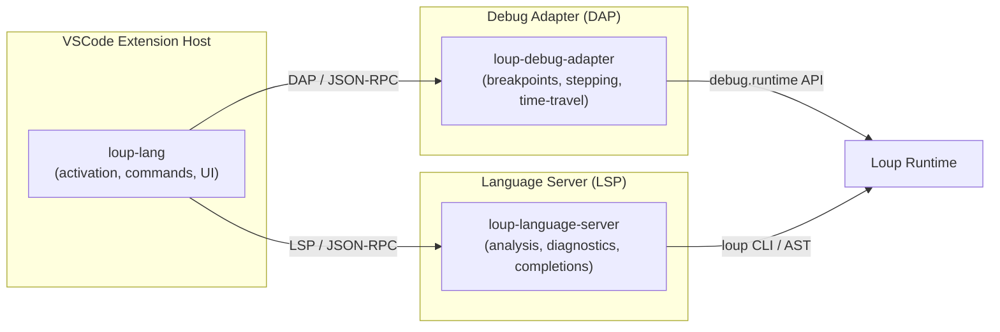

# Loup VSCode Extension — Architecture Proposal

This document describes the architecture, feature sets, and phased implementation plan for the Visual Studio Code extension providing first-class support for the **Loup programming language v1.20**, including mode-flavored file extensions and integrated debugging with time-travel capabilities.

---

## 1 — High-Level Architecture

The extension is structured as a **TypeScript monorepo** containing three cooperating packages:

| Package | Role |
|---|---|
| **`loup-lang` (`packages/extension`)** | VS Code client extension: activation, contributed commands, status bar items, settings, webview panels (time-travel UI). |
| **`loup-language-server` (`packages/language-server`)** | Out-of-process Language Server Protocol (LSP) server. Parses Loup source, provides diagnostics, completions, hover info, go-to-definition, etc. |
| **`loup-debug-adapter` (`packages/debug-adapter`)** | Debug Adapter Protocol (DAP) implementation. Communicates with the Loup runtime's `debug.runtime.DebugRuntime` interface for breakpoints, stepping, variable inspection, and time-travel replay. |

---

## 2 — File Extensions & Execution Modes (§1-13.0.0)

| Extension | Role | Allowed `@mode` Declarations | Default Fallback Mode |
|---|---|---|---|
| `.loup` | General source (library or any mode) | `web.scripted`, `web.compiled`, `host.scripted`, `host.dual`, `host.native`, `freestanding`, `portable` | `@mode(host.scripted)` |
| `.lpscr` | Host-script or dual-mode file | `host.scripted`, `host.dual`, or omitted | `@mode(host.scripted)` |
| `.lpfree` | Freestanding-exclusive code | `freestanding` or omitted | `@mode(freestanding)` |
| `.lpweb` | Web-hosted-exclusive code | `web.scripted`, `web.compiled`, or omitted | `@mode(web.scripted)` |
| `.lphc` | Host-compiled (native) code | `host.native`, `host.dual`, or omitted | `@mode(host.native)` |
| `.lppkg` | Package manifest (`package.lppkg`) | — | — |
