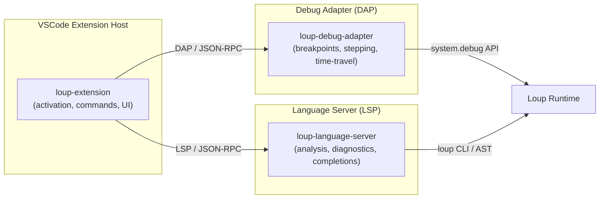

# Loup VSCode Extension — Architecture Proposal

This document proposes the architecture, feature sets, and phased implementation plan for a Visual Studio Code extension that provides first-class support for the **Loup programming language v0.4**, including integrated debugging with time-travel capabilities.

---

## 1 — High-Level Architecture

The extension is structured as a **TypeScript monorepo** containing three cooperating packages:



| Package | Role |
|---|---|
| **`loup-extension`** | VS Code client extension: activation, contributed commands, status bar items, settings, webview panels (time-travel UI). |
| **`loup-language-server`** | Out-of-process Language Server Protocol (LSP) server. Parses Loup source, provides diagnostics, completions, hover info, go-to-definition, etc. |
| **`loup-debug-adapter`** | Debug Adapter Protocol (DAP) implementation. Communicates with the Loup runtime's `system.debug.DebugRuntime` interface for breakpoints, stepping, variable inspection, and time-travel replay. |

### Why three packages?

- **LSP + DAP are protocol-standard** — keeps the extension interoperable with other editors later.
- **Out-of-process isolation** — the language server can be heavy (parser, type-checker) without blocking the extension host.
- **Independent lifecycle** — the debug adapter can be updated/replaced independently (e.g., when the Loup runtime ships a native DAP server).

---

## 2 — Feature Breakdown by Layer

### Layer 0 — Baseline: Syntax Highlighting & File Association

| Feature | Notes |
|---|---|
| **File extension** `.loup` | `loup.pkg` and `loup.lock` recognized separately |
| **TextMate grammar** | Full tokenisation of Loup v0.4 syntax |
| **Language configuration** | Auto-close pairs `{}()[]""''`, comment toggling `//` / `/* */`, indentation rules, bracket matching |
| **Semantic token types** | `keyword`, `type`, `enum`, `enumMember`, `function`, `variable`, `parameter`, `property`, `decorator` (`@jsexport`), `namespace`, `string`, `number`, `operator`, `comment` |

Key highlights for the TextMate grammar, driven directly from the spec:

- **Keywords & control flow**: `let`, `var`, `fun`, `async`, `await`, `return`, `if`, `else`, `for`, `while`, `do`, `match`, `break`, `continue`, `defer`, `with`, `portal`, `spawn`, `try`, `catch`, `finally`, `throw`, `from`, `import`, `pub`, `static`, `class`, `dynamic`, `interface`, `enum`, `extern`, `in`
- **Types**: `int`, `float`, `bool`, `string`, `bytes`, `list`, `dict`, `set`, `tuple`, `fn`, `Any`, `Task`, `Option`, `Result`, `Signal`, `View`, `Template`
- **Annotations**: `@jsexport` (and future annotations)
- **Multiline strings**: `"""(...)` / `'''(...)` with alignment-anchor `P` rules
- **Template fences**: ` ```(language):(format) ` blocks with embedded directives `` and inline expressions `{$ ... $}`
- **Interpolated strings**: `{$ expr $}` inside single/double-quoted strings
- **Dynamic field access**: `!{...}` syntax
- **Optionality sugar**: `T?`, `?.`, `??`
- **Propagation operator**: `expr?`

---

### Layer 1 — Language Server (LSP) Core

| Feature | LSP Method | Notes |
|---|---|---|
| **Diagnostics** | `textDocument/publishDiagnostics` | Parse errors, type errors, alignment violations (MLS), component resolution errors |
| **Hover** | `textDocument/hover` | Type info, doc comments, rendered signature |
| **Completion** | `textDocument/completion` | Keywords, types, identifiers, `system.*` namespace members, template directives, descriptor keys |
| **Signature help** | `textDocument/signatureHelp` | Function/method parameter info |
| **Go to definition** | `textDocument/definition` | Navigate to declarations, imported symbols, `from ... import` targets |
| **Find references** | `textDocument/references` | All usages of a symbol |
| **Rename** | `textDocument/rename` | Symbol rename across files |
| **Document symbols** | `textDocument/documentSymbol` | Outline view: functions, classes, enums, interfaces, portals, `extern` decls |
| **Workspace symbols** | `workspace/symbol` | Cross-file symbol search |
| **Code actions** | `textDocument/codeAction` | Quick fixes (auto-import, add `await`, box/unbox, add wildcard arm to `match`) |
| **Formatting** | `textDocument/formatting` | Delegate to `loup fmt` CLI or built-in formatter |
| **Folding ranges** | `textDocument/foldingRange` | Blocks, template fences, multiline strings, `match` arms, `enum` bodies |
| **Semantic tokens** | `textDocument/semanticTokens/full` | Rich token classification beyond TextMate |

#### Loup-specific LSP features

- **Template fence language injection**: Report embedded language IDs (e.g., `html`, `py`, `sql`) so VSCode can apply sub-grammars inside template fences.
- **`loup.pkg` support**: Diagnostics for package manifests (dependency versions, target profiles). Completions for `system.*` module names.
- **Portal awareness**: Document symbols include `portal` names; go-to-definition works for portal activations.
- **Enum exhaustiveness warnings**: Warn when a `match` is missing arms (spec section 6).
- **Platform profile enforcement**: Warn when using `system.fs` in a file marked `[target.browser]`.

---

### Layer 2 — Debugging (DAP)

The debug adapter integrates with Loup's `system.debug.DebugRuntime` API, which provides native tracing, portal activation, and time-travel capture.

#### Standard DAP features

| Feature | DAP Request | Notes |
|---|---|---|
| **Launch / Attach** | `launch` / `attach` | Launch `loup run <file>`, or attach to running Loup process |
| **Breakpoints** | `setBreakpoints` | Line breakpoints, conditional breakpoints, logpoints |
| **Stepping** | `next` / `stepIn` / `stepOut` | Synchronous and across `await` suspension points |
| **Stack frames** | `stackTrace` | Including async call chains |
| **Variables** | `variables` / `evaluate` | Primitive and boxed values; dynamic fields via `!{}` shown separately |
| **Watch expressions** | `evaluate` | Loup expression evaluation in current scope |
| **Exception breakpoints** | `setExceptionBreakpoints` | Break on all, uncaught, or specific types |
| **Loaded sources** | `loadedSources` | Show all `.loup` files in the debug session |

#### Loup-specific debug features

| Feature | Mechanism | Notes |
|---|---|---|
| **Portal breakpoints** | Custom breakpoint type | Set breakpoints by portal name (explicit or callable portals), optionally with conditions and `once` flag — maps directly to `DebugRuntime.activatePortal()` |
| **Time-travel debugging** | `DebugRuntime.startCaptureServer()` | Start an in-process capture server; extension UI shows a timeline scrubber |
| **Reverse stepping** | Time-travel capture | Step backward through captured trace history |
| **Trace event viewer** | `TraceEvent` stream | View `Call`, `Return`, `Line`, `Exception`, `Await`, `Resume`, `Portal`, `Signal` events in a panel |
| **Signal inspector** | `Signal` trace events | Show reactive signal dependency graph and value changes over time |
| **Async task viewer** | Task lifecycle events | Visualize `Task[T]` creation, suspension, resumption, completion/failure |
| **`await group` visualizer** | Structured concurrency events | Show child tasks within a group, their states, and cancellation propagation |
| **MCP debug server** | `DebugRuntime.startMcpServer()` | Enable agent-driven debugging through the MCP protocol |

#### Launch configuration (`launch.json`)

```jsonc
{
  "type": "loup",
  "request": "launch",
  "name": "Run Loup Script",
  "program": "${file}",
  "args": [],
  "target": "cli",          // "cli" | "browser" | "service"
  "enableTimeTravel": false, // start capture server on launch
  "portalBreakpoints": [     // pre-activate portals
    { "name": "checkout.enter", "condition": "total == 0", "once": true }
  ],
  "env": {}
}
```

---

### Layer 3 — Rich Editor Experience

| Feature | Notes |
|---|---|
| **Snippet library** | `fun`, `async fun`, `enum`, `match`, `for...in`, `for await`, `await group { spawn }`, `portal`, `try/catch`, template fence, `extern js`, `@jsexport`, `loup.pkg` |
| **Code lens** | "Run" / "Debug" above entry-point scripts; "N references" on functions/classes; "N activations" on portals |
| **Inlay hints** | Inferred types on `let`/`var`, async return types, enum variant payload types |
| **Breadcrumbs** | Namespace → module → class/enum → function → portal path |
| **Outline view** | Functions, classes, enums, interfaces, portals, `extern` declarations, `@jsexport` functions |
| **Color decorators** | Color swatches in HTML template fences |
| **Bracket pair colorization** | Works naturally with `{}()[]`, plus custom for `{$ $}`, ``, `!{}` |
| **Embedded language support** | Language injection in template fences: HTML, TypeScript, Python, SQL, etc. |

---

### Layer 4 — Toolchain Integration

| Feature | Notes |
|---|---|
| **Task provider** | Auto-detect `loup run`, `loup build`, `loup test` tasks from `loup.pkg` |
| **Problem matcher** | Parse `loup` CLI output for errors/warnings |
| **Terminal profile** | "Loup REPL" terminal profile using `loup repl` |
| **Tree view: Dependencies** | Parse `loup.pkg` and `loup.lock` to show a dependency tree |
| **Tree view: Platform targets** | Show `cli` / `browser` / `service` targets and their capability gates |

---

## 3 — Project Structure (Proposed)

```text
loup-vscode-extension/
├── specs/
│   └── Loup-Language-Spec-v0.4.md
├── packages/
│   ├── extension/                   # VSCode extension client
│   │   ├── src/
│   │   │   ├── extension.ts         # Activation, command registration
│   │   │   ├── commands/            # Command implementations
│   │   │   ├── providers/           # CodeLens, InlayHints, TreeViews
│   │   │   ├── debug/               # Debug adapter integration
│   │   │   └── webviews/            # Time-travel timeline UI
│   │   ├── syntaxes/
│   │   │   ├── loup.tmLanguage.json # TextMate grammar
│   │   │   ├── loup-pkg.tmLanguage.json
│   │   │   └── loup-template-*.json # Injection grammars for template fences
│   │   ├── language-configuration.json
│   │   ├── snippets/
│   │   │   └── loup.code-snippets
│   │   └── package.json             # Extension manifest (contributes, activation)
│   ├── language-server/             # LSP server (out-of-process)
│   │   ├── src/
│   │   │   ├── server.ts            # LSP entry point
│   │   │   ├── parser/              # Loup parser (incremental, error-recovering)
│   │   │   ├── analyzer/            # Type checker, scope resolution
│   │   │   ├── completions/         # Completion providers
│   │   │   ├── diagnostics/         # Diagnostic providers
│   │   │   └── symbols/             # Symbol providers
│   │   └── package.json
│   └── debug-adapter/              # DAP server
│       ├── src/
│       │   ├── adapter.ts           # DAP entry point
│       │   ├── runtime-bridge.ts    # Bridge to Loup system.debug API
│       │   ├── portal-breakpoints.ts
│       │   ├── time-travel/         # Time-travel session management
│       │   └── task-visualizer.ts   # Async task tree
│       └── package.json
├── test/                            # Integration + e2e tests
├── .vscode/                         # Extension development settings
├── package.json                     # Root workspace package.json
├── tsconfig.json
└── README.md
```

---

## 4 — Phased Delivery

| Phase | Milestone | Contents |
|---|---|---|
| **P0 — Core Editing** | MVP | TextMate grammar, language configuration, snippets, file icons, `loup.pkg` support |
| **P1 — Language Intelligence** | Alpha | LSP server with diagnostics, completions, hover, go-to-definition, document symbols. Basic formatting. |
| **P2 — Standard Debugging** | Beta | DAP adapter with launch/attach, breakpoints, stepping, variables, watch, exception breakpoints. |
| **P3 — Loup-Specific Debug** | Beta+ | Portal breakpoints, time-travel capture/replay, trace event panel, signal inspector. |
| **P4 — Rich UX** | 1.0 | Code lens, inlay hints, embedded language injection in template fences, tree views, REPL integration. |
| **P5 — Advanced** | 1.x | Reverse stepping, `await group` visualizer, MCP debug server integration, async task tree, refactoring actions. |

---

## 5 — Key Technical Decisions

### 5.1 Parser Strategy
The TextMate grammar handles colorisation; the LSP server uses a **hand-written recursive-descent parser** built from the grammar excerpts in spec section 13. This parser must be:
- **Incremental** — re-parse only changed regions
- **Error-recovering** — produce partial ASTs for real-time diagnostics
- **Alignment-aware** — enforce the `P` anchor rules for multiline strings and template fences

### 5.2 Template Fence Language Injection
Template fences embed other languages (`html`, `py`, `sql`, etc.). The extension uses VSCode's **embedded languages** API:
- A TextMate injection grammar matches the fence `language` descriptor and assigns the appropriate embedded scope.
- The LSP server reports `embeddedLanguages` to enable completions/diagnostics from other language extensions inside fences.

### 5.3 Debug Adapter Communication
The DAP server communicates with the running Loup process via the `system.debug.DebugRuntime` API surface:
- **Launch mode**: The adapter spawns `loup run --debug` and connects over a JSON-RPC channel.
- **Attach mode**: The adapter connects to the debug port of an already-running Loup process.
- **Time-travel**: Activating time-travel starts a `CaptureServer` inside the runtime; the adapter streams `TraceEvent` data back to the extension for timeline rendering.

### 5.4 Portal Breakpoints
Portal breakpoints are a **custom breakpoint type** contributed by the extension:
- Users can set them from the command palette or inline via code lens.
- They map 1:1 to `DebugRuntime.activatePortal(name, condition, once)`.
- Callable portals (implicit on function entry) use fully-qualified function names.

### 5.5 Technology Stack
- **Language**: TypeScript throughout
- **Build**: esbuild for extension bundling; tsc for type checking
- **LSP library**: `vscode-languageserver` / `vscode-languageclient`
- **DAP library**: `@vscode/debugadapter` / `@vscode/debugprotocol`
- **Testing**: Vitest for unit tests; `@vscode/test-electron` for integration tests
- **Monorepo management**: npm workspaces

---

## 6 — Verification Plan

Since this is a greenfield project, verification will be established alongside each phase:

### Phase 0 (Core Editing)
- **Manual**: Open `.loup` files and visually verify syntax highlighting covers all constructs (keywords, types, template fences, multiline strings, interpolation, dynamic access `!{}`, annotations, etc.)
- **Automated**: Snapshot-test the TextMate grammar using `vscode-tmgrammar-test` against sample `.loup` files covering each grammar production from spec section 13.

### Phase 1 (LSP)
- **Automated**: Unit tests for the parser against all grammar excerpts from the spec. Unit tests for each LSP provider (completions, diagnostics, hover, etc.).
- **Integration**: `@vscode/test-electron` tests that open sample Loup projects and assert diagnostics, completions, and navigation.

### Phase 2–3 (Debug)
- **Automated**: Unit tests for DAP message handling. Mock `DebugRuntime` for portal activation and trace event streaming.
- **Manual**: Launch a sample Loup program, set breakpoints, step through code, and inspect variables. This requires a functional Loup runtime.

> [!IMPORTANT]
> Phases 2+ depend on a functional Loup runtime and toolchain (`loup run`, `loup build`, `system.debug` APIs). If the runtime is not yet available, we will build the debug adapter against a mock runtime and validate end-to-end when the runtime ships.
