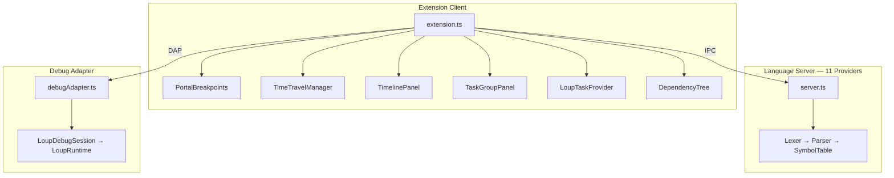

# Loup VSCode Extension — Final Walkthrough

## Architecture

---

## All Files

### Extension Client (`packages/extension/`)

| File | Phase |
|---|---|
| [extension.ts](file:///Users/myron/ccai/repos/components/loup-vscode-extension/packages/extension/src/extension.ts) | P0-P5 |
| [portalBreakpoints.ts](file:///Users/myron/ccai/repos/components/loup-vscode-extension/packages/extension/src/portalBreakpoints.ts) | P3 |
| [timeTravelManager.ts](file:///Users/myron/ccai/repos/components/loup-vscode-extension/packages/extension/src/timeTravelManager.ts) | P3 |
| [timelinePanel.ts](file:///Users/myron/ccai/repos/components/loup-vscode-extension/packages/extension/src/timelinePanel.ts) | P3 |
| [taskGroupPanel.ts](file:///Users/myron/ccai/repos/components/loup-vscode-extension/packages/extension/src/taskGroupPanel.ts) | P4 |
| [taskProvider.ts](file:///Users/myron/ccai/repos/components/loup-vscode-extension/packages/extension/src/taskProvider.ts) | P5 |
| [dependencyTree.ts](file:///Users/myron/ccai/repos/components/loup-vscode-extension/packages/extension/src/dependencyTree.ts) | P5 |

### Language Server (`packages/language-server/`)

| File | Phase |
|---|---|
| [lexer.ts](file:///Users/myron/ccai/repos/components/loup-vscode-extension/packages/language-server/src/parser/lexer.ts) | P1 |
| [ast.ts](file:///Users/myron/ccai/repos/components/loup-vscode-extension/packages/language-server/src/parser/ast.ts) | P1 |
| [parser.ts](file:///Users/myron/ccai/repos/components/loup-vscode-extension/packages/language-server/src/parser/parser.ts) | P1 |
| [symbolTable.ts](file:///Users/myron/ccai/repos/components/loup-vscode-extension/packages/language-server/src/symbols/symbolTable.ts) | P1 |
| [server.ts](file:///Users/myron/ccai/repos/components/loup-vscode-extension/packages/language-server/src/server.ts) | P1-P4 |

### Debug Adapter (`packages/debug-adapter/`)

| File | Phase |
|---|---|
| [loupRuntime.ts](file:///Users/myron/ccai/repos/components/loup-vscode-extension/packages/debug-adapter/src/loupRuntime.ts) | P2 |
| [loupDebugSession.ts](file:///Users/myron/ccai/repos/components/loup-vscode-extension/packages/debug-adapter/src/loupDebugSession.ts) | P2 |
| [debugAdapter.ts](file:///Users/myron/ccai/repos/components/loup-vscode-extension/packages/debug-adapter/src/debugAdapter.ts) | P2 |
