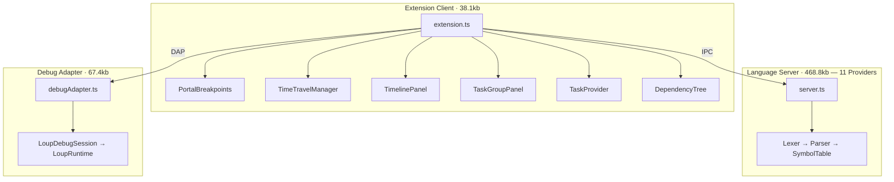

# Loup VSCode Extension — Final Walkthrough

## Architecture



---

## All Files Created

### Extension Client (`packages/extension/`)

| File | Phase |
|---|---|
| [extension.ts](file:///Users/myron/repos/loup-vscode-extension/packages/extension/src/extension.ts) | P0-P5 |
| [portalBreakpoints.ts](file:///Users/myron/repos/loup-vscode-extension/packages/extension/src/portalBreakpoints.ts) | P3 |
| [timeTravelManager.ts](file:///Users/myron/repos/loup-vscode-extension/packages/extension/src/timeTravelManager.ts) | P3 |
| [timelinePanel.ts](file:///Users/myron/repos/loup-vscode-extension/packages/extension/src/timelinePanel.ts) | P3 |
| [taskGroupPanel.ts](file:///Users/myron/repos/loup-vscode-extension/packages/extension/src/taskGroupPanel.ts) | P4 |
| [taskProvider.ts](file:///Users/myron/repos/loup-vscode-extension/packages/extension/src/taskProvider.ts) | P5 |
| [dependencyTree.ts](file:///Users/myron/repos/loup-vscode-extension/packages/extension/src/dependencyTree.ts) | P5 |

### Language Server (`packages/language-server/`)

| File | Phase |
|---|---|
| [lexer.ts](file:///Users/myron/repos/loup-vscode-extension/packages/language-server/src/parser/lexer.ts) | P1 |
| [ast.ts](file:///Users/myron/repos/loup-vscode-extension/packages/language-server/src/parser/ast.ts) | P1 |
| [parser.ts](file:///Users/myron/repos/loup-vscode-extension/packages/language-server/src/parser/parser.ts) | P1 |
| [symbolTable.ts](file:///Users/myron/repos/loup-vscode-extension/packages/language-server/src/symbols/symbolTable.ts) | P1 |
| [server.ts](file:///Users/myron/repos/loup-vscode-extension/packages/language-server/src/server.ts) | P1-P4 |

### Debug Adapter (`packages/debug-adapter/`)

| File | Phase |
|---|---|
| [loupRuntime.ts](file:///Users/myron/repos/loup-vscode-extension/packages/debug-adapter/src/loupRuntime.ts) | P2 |
| [loupDebugSession.ts](file:///Users/myron/repos/loup-vscode-extension/packages/debug-adapter/src/loupDebugSession.ts) | P2 |
| [debugAdapter.ts](file:///Users/myron/repos/loup-vscode-extension/packages/debug-adapter/src/debugAdapter.ts) | P2 |

---

## Capability Summary

| Category | Count | Items |
|---|---|---|
| **LSP Providers** | 11 | Diagnostics, Completions, Hover, Document Symbols, Go-to-Definition, Folding, Semantic Tokens, Formatting, Code Actions, Signature Help, Workspace Symbols |
| **DAP Features** | 10 | Launch, Attach, Breakpoints, Exception BP, Stepping, Stack Traces, Scopes, Variables, Evaluation, Exception Info |
| **Commands** | 13 | Portal (toggle/add/remove/clear), Time-travel (start/stop/timeline/open/save/navigate), Task Groups, Refresh Deps, Open REPL |
| **Views** | 2 | Portal Breakpoints, Dependency Tree |
| **Webviews** | 2 | Timeline Panel, Task Group Visualizer |
| **Other** | 3 | Task Provider, Problem Matcher, REPL Terminal Profile |

## Build Verification

```
$ npm run build
> debug-adapter   →  67.4kb ⚡
> extension       →  38.1kb ⚡
> language-server → 468.8kb ⚡
```

All three packages compile with zero errors across all phases.
